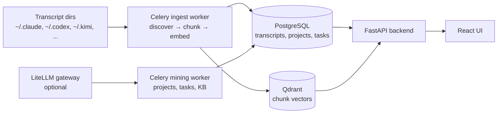

# Burdello Bum-Bum

Local-first knowledge base for AI coding-assistant session transcripts.

Point it at the transcript directories your assistants already write, and it turns them into
searchable transcripts, mined projects, extracted tasks, and a curated knowledge tree.



## Requirements

### Minimum (ingest + search)

- Docker with Compose v2
- 8 GB RAM
- 4 GB free disk (Docker images + Postgres/Qdrant volumes + ~420 MB embedding model)
- 2 CPU cores
- Network access to huggingface.co (for the embedding model download on first run)

### Recommended (mining with local LLM)

- 16 GB RAM
- 4 CPU cores
- A LiteLLM-compatible endpoint (e.g. local Ollama, vLLM, or a hosted gateway)

### Optional

- `LITELLM_URL` / `LITELLM_API_KEY` — mining gateway. Ingest and search work without one.
- `MCP_BRIDGE_TOKEN` — bearer token for the `/api/v1/mcp/*` routes.
- `TODOIST_API_TOKEN` — enables Todoist export.
- `CLOUDFLARE_TUNNEL_TOKEN` — only for the `tunnel` profile.

### Supported platforms

- macOS (Docker Desktop or OrbStack)
- Linux (Docker Engine + Compose v2)
- Windows not tested; Docker Desktop with WSL2 should work

## Quick start

```bash
git clone <this-repo> burdello-bum-bum
cd burdello-bum-bum
cp .env.example .env          # set LITELLM_URL / LITELLM_API_KEY if you have a gateway
docker compose up -d --build
```

Schema is created on first startup (`init_db` runs `create_all` plus the `vector` extension),
so there is no migration step for a fresh install.

Then:

| URL | What |
|---|---|
| http://localhost:3001 | Web UI |
| http://localhost:8001/docs | OpenAPI docs |
| http://localhost:8001/health | Health check |
| http://localhost:6333/dashboard | Qdrant dashboard |

The first start downloads the embedding model (~420 MB) and builds the images, so give it a
few minutes.

## Ingest your transcripts

The compose file mounts these host directories read-only into the container:

`~/.claude`, `~/.codex`, `~/.kimi`, `~/.vibe`, `~/.gemini`, `~/.openclaw-autoclaw`, `~/.pi`, `~/.omp`

Docker creates missing directories empty, so the stack starts even if you only use one of
those tools. To add another location, append a volume in the same shape; the recursive
discovery scan picks it up.

Trigger a scan from the UI, or:

```bash
curl -X POST http://localhost:8001/api/v1/ingest/
curl http://localhost:8001/api/v1/ingest/status
```

A single file:

```bash
curl -X POST "http://localhost:8001/api/v1/ingest/session?path=/home/bbuser/.claude/projects/<project>/<uuid>.jsonl"
```

## Supported transcript formats

| Provider | Skill | Reads |
|---|---|---|
| Claude Code | `claude_code` | `~/.claude/projects/<project>/*.jsonl` |
| Codex CLI | `codex` | `~/.codex/sessions/YYYY/MM/DD/*.jsonl` |
| Kimi CLI | `kimi` | `~/.kimi/sessions/<group>/<session>/wire.jsonl` |
| Vibe CLI | `vibe` | `~/.vibe/logs/session/session_*.json` |
| Oh My Pi | `omp` | `~/.omp/agent/sessions/**/*.jsonl` |
| Pi | `pi` | `~/.pi/agent/sessions/**/*.jsonl` |
| Antigravity CLI | `agy` | `~/.gemini/antigravity-cli/**` |
| OpenClaw | `openclaw` | `~/.openclaw*/agents/main/sessions/*.jsonl` |
| Goose | `goose` | `~/.local/share/goose/exports/*.json` |
| OpenCode | `opencode` | `~/.local/share/opencode/exports/*.json` |
| Aider | `aider` | `<project>/.aider.chat.history.md` |
| Anything else | `generic` | JSONL / JSON / Markdown with role-tagged messages |

Goose and OpenCode keep sessions in SQLite, so they need one export step before ingest:

```bash
python scripts/export_goose_sessions.py
python scripts/export_opencode_sessions.py
```

Adding a provider means subclassing `BaseSkill` in `backend/skills/providers/` and registering it
in that package's `__init__.py`.

## Configuration

`.env` is read by compose and honours these:

| Variable | Default | Purpose |
|---|---|---|
| `LITELLM_URL` | `http://host.docker.internal:4000` | Mining gateway |
| `LITELLM_API_KEY` | empty | Mining gateway key |
| `BB_EMBEDDING_MODEL` | `sentence-transformers/all-mpnet-base-v2` | Embedding model |
| `BB_MINING_MODEL` | `kimi` | Model name sent to the gateway |
| `MCP_BRIDGE_TOKEN` | empty | Bearer token for the `/api/v1/mcp/*` routes |
| `TODOIST_API_TOKEN` | empty | Enables Todoist export |
| `CLOUDFLARE_TUNNEL_TOKEN` | empty | Only for the `tunnel` profile |
| `VITE_ALLOWED_HOSTS` | empty | Extra comma-separated hostnames accepted by the Vite dev server |

Service-to-service URLs (`DATABASE_URL`, `QDRANT_URL`, `REDIS_URL`, `CELERY_BROKER_URL`) are
fixed to the compose network in `docker-compose.yml`. Change them there or in a
`docker-compose.override.yml`, which compose merges automatically.

Further backend settings (`BB_CHUNK_SIZE`, `BB_CHUNK_OVERLAP`, `BB_LOG_LEVEL`, …) live in
`backend/core/config.py`.

## Development

Backend (Python 3.11+, run from the repo root):

```bash
python -m venv .venv && source .venv/bin/activate
pip install -e ".[dev]"
pytest                      # unit + API tests
ruff check backend
```

Schema evolution uses Alembic (`alembic.ini` → `backend/migrations/`), driven by the same
`DATABASE_URL`:

```bash
alembic revision --autogenerate -m "add x"
alembic upgrade head
```

Frontend (Node 20):

```bash
cd frontend
npm install
npm run dev                 # http://localhost:3000, proxies /api to localhost:8000
npm test                    # vitest
```

Set `VITE_API_PROXY` to point the dev server at a different backend, and
`VITE_ALLOWED_HOSTS` (comma-separated) to reach it over a tailnet or reverse proxy.

The compose stack mounts `./backend` and `./frontend` as live sources, so edits reload without a
rebuild. Rebuild only when dependencies change.

### Layout

```
backend/
  api/routers/    FastAPI routers (all under /api/v1)
  core/           settings, SQLAlchemy models
  pipeline/       discovery, chunking, embedding, mining, Celery tasks
  skills/         one provider per transcript format
  knowledge/      KB tree seeds, hierarchy, draft generation
  search/         hybrid search + QA
  migrations/     Alembic
frontend/         React + Vite + Tailwind SPA
worker/           Cloudflare Worker exposing the MCP tools
k8s/              Kubernetes manifests (not needed for local use)
deploy/           compose/launchd helpers used by the original author
```

## Notes

- The stack is single-user and unauthenticated by default. Do not expose it to the internet
  without putting auth in front of it. The `/api/v1/mcp/*` routes are the exception: they
  require `MCP_BRIDGE_TOKEN`.
- `docker compose --profile tunnel up -d cloudflared` starts an optional Cloudflare Tunnel
  connector; it needs `CLOUDFLARE_TUNNEL_TOKEN`.
- `docker compose stop` keeps volumes. `docker compose down -v` wipes Postgres, Qdrant and Redis.
- `deploy/` and `k8s/` contain the original author's personal infrastructure scripts
  (launchd plists, SSH relays, Tailscale, private registry). They are not needed for local
  use and will not work without the author's environment. Use `docker compose up` instead.

## License

MIT